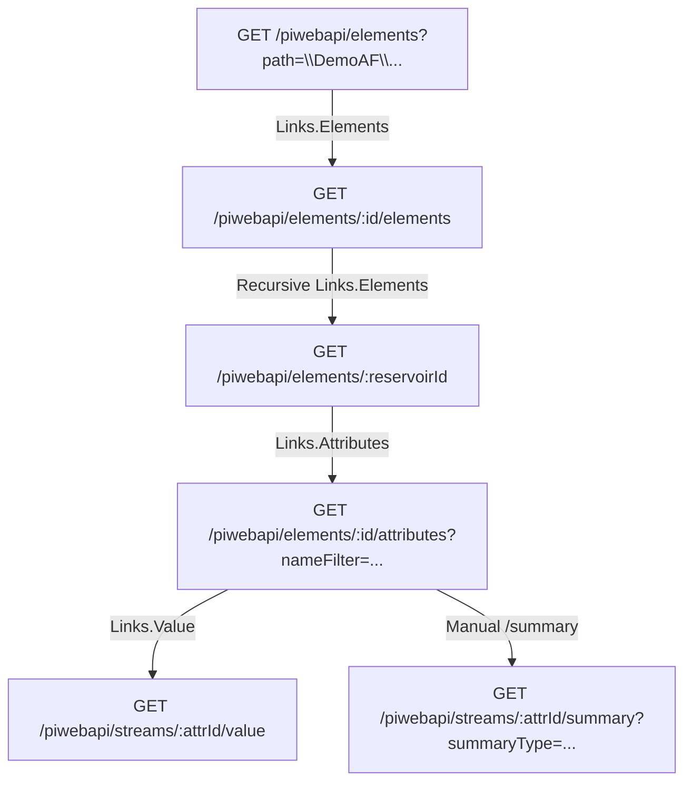

# PI Web API & Ingestion Mock Server — API Reference Guide

Server Base URL: `http://localhost:3001`  
Production Real Base URL: `https://192.168.1.6/piwebapi`

> **The dataset is generated.** `pi-mock-server/db.json` is produced by
> `node scripts/generate-pi-db.mjs` from the hierarchy and field mappings in
> `PI_WEB_API_USAGE_GUIDE`. Edit the generator, not the JSON — hand edits are
> overwritten on the next run. `npm run mock:verify` then re-checks the five PI
> endpoints and the guide-conformance invariants against the running server.
>
> The seed currently holds **29 AF elements across 9 tiers, 4 reservoirs, 13
> attributes per reservoir and 3 villages**. Every relational table below
> therefore returns **4 rows** (one per reservoir), not the single row shown in
> earlier revisions of this file. The samples are trimmed to one row for
> readability; the Ambikapur `Proposed 1.00 LL MBR-Outlet-1` record reproduces
> the guide's printed JSON byte-for-byte.

---

## 1. Authentication & Headers

| Key | Value / Example | Notes |
|---|---|---|
| **Base URL** | `http://localhost:3001` | Configurable via `PORT` env |
| **Auth Type** | HTTP Basic Authentication | Header: `Authorization: Basic <base64>` |
| **Admin Creds** | `.\piadmin` / `JJM@123` | Base64: `LlxwaWFkbWluOkpKTUAxMjM=` |
| **Read-Only Creds** | `WebAppUser` / `WebAppUser@123` | Base64: `V2ViQXBwVXNlcjpXZWJBcHBVc2VyQDEyMw==` |
| **CORS** | Enabled (`*`) | Accepts cross-origin requests from Vite (`localhost:5173`) |

> **Note:** The mock server permits unauthenticated requests during local dev so links can be clicked directly in web browsers without auth prompts.

---

## 2. API Catalog Overview



| Group | Endpoints |
|---|---|
| **PI Web API** (§3) | `/piwebapi/elements`, `/piwebapi/elements/:id`, `/piwebapi/elements/:id/elements`, `/piwebapi/elements/:id/attributes`, `/piwebapi/streams/:id/value`, `/piwebapi/streams/:id/summary` |
| **Ingested tables** (§4.1–4.8) | `/api/chlorine-data`, `/api/chlorine-history`, `/api/pressure-data`, `/api/pressure-history`, `/api/water-consumption`, `/api/water-consumption-history`, `/api/communication-status`, `/api/system-state-values` |
| **Non-PI collections** (§4.9–4.10) | `/api/demographics`, `/api/asset-details` |

---

## 3. PI Web API Endpoints

### Endpoint 1: Resolve Root Path to WebID
Resolves the root AF path (`\\DemoAF\JJM\JJM\Maharashtra`) into a root WebId.

- **Method**: `GET`
- **Path**: `/piwebapi/elements`
- **Query Params**:
  - `path` (string, required): Asset Framework hierarchy path (e.g. `\\DemoAF\JJM\JJM\Maharashtra`).
- **Example URL**: `http://localhost:3001/piwebapi/elements?path=\\DemoAF\JJM\JJM\Maharashtra`

#### Response (`200 OK`):
```json
{
  "WebId": "E0k-7zR3_XEEa5vK9QdYwAAA_qE0yBq_k5xG_Q1AAA",
  "Id": "19b484fe-bf1b-419b-a7e8-e501a3501a01",
  "Name": "Maharashtra",
  "Path": "\\\\DemoAF\\JJM\\JJM\\Maharashtra",
  "TemplateName": null,
  "HasChildren": true,
  "Links": {
    "Self": "http://localhost:3001/piwebapi/elements/E0k-7zR3_XEEa5vK9QdYwAAA_qE0yBq_k5xG_Q1AAA",
    "Elements": "http://localhost:3001/piwebapi/elements/E0k-7zR3_XEEa5vK9QdYwAAA_qE0yBq_k5xG_Q1AAA/elements",
    "Attributes": "http://localhost:3001/piwebapi/elements/E0k-7zR3_XEEa5vK9QdYwAAA_qE0yBq_k5xG_Q1AAA/attributes"
  }
}
```

---

### Endpoint 1b: Single Element Lookup by WebID

> `Id` is a GUID PI assigns arbitrarily. The generator derives it deterministically
> from the element path, except where `PI_WEB_API_USAGE_GUIDE` prints a specific
> value (the Maharashtra root, the Ambikapur MBR and its `Chlorine` attribute),
> which are pinned so the guide's printed responses stay valid.
Resolves any single AF element by its unique WebId (used when clicking `Links.Self`).

- **Method**: `GET`
- **Path**: `/piwebapi/elements/:webId`
- **Example URL**: `http://localhost:3001/piwebapi/elements/REGION_AMRAVATI_WEBID`

#### Response (`200 OK`):
```json
{
  "WebId": "REGION_AMRAVATI_WEBID",
  "Id": "4da2083b-ff25-3631-8beb-f36557c5399d",
  "Name": "Region-Amravati",
  "Path": "\\\\DemoAF\\JJM\\JJM\\Maharashtra\\Region-Amravati",
  "TemplateName": null,
  "HasChildren": true,
  "Links": {
    "Self": "http://localhost:3001/piwebapi/elements/REGION_AMRAVATI_WEBID",
    "Elements": "http://localhost:3001/piwebapi/elements/REGION_AMRAVATI_WEBID/elements",
    "Attributes": "http://localhost:3001/piwebapi/elements/REGION_AMRAVATI_WEBID/attributes"
  }
}
```

---

### Endpoint 2: Recursive Child Element Enumeration
Discovers all child elements under a parent element. Traversed down the 8 tiers from State to Reservoir.

- **Method**: `GET`
- **Path**: `/piwebapi/elements/:parentWebId/elements`
- **Query Params**:
  - `maxCount` (integer, optional): Maximum items to return (default: `100000`).
  - `searchFullHierarchy` (`true` | `false`, optional): return every descendant
    rather than only direct children. Standard PI Web API; lets a client count
    the estate in one request instead of one per node.
  - `templateName` (string, optional): keep only elements on that template — use
    it with `searchFullHierarchy=true` to list every reservoir (§3) directly.
  - `nameFilter` (string, optional): exact match, or a trailing `*` wildcard
    (e.g. `Region-*`).
- **Example URL**: `http://localhost:3001/piwebapi/elements/AMBIKAPUR_WEBID/elements`

#### Response (`200 OK`):
```json
{
  "Items": [
    {
      "WebId": "E0k-7zR3_XEEa5vK9QdYwAAA_AMBIKAPUR_MBR1_WEBID",
      "Id": "7a3311de-3a9d-4e9e-b152-7b19810a9912",
      "Name": "Proposed 1.00 LL MBR-Outlet-1",
      "Path": "\\\\DemoAF\\JJM\\JJM\\Maharashtra\\Region-Amravati\\Circle-Akola\\Division-Akola\\Sub Division-Akola\\Block-Akola\\Scheme-20027951 - Khambora 60 VRRWSS Tq. & Dist. Akola\\Ambikapur\\Proposed 1.00 LL MBR-Outlet-1",
      "TemplateName": "MJP Reservoir MBR - Level - Active",
      "HasChildren": false,
      "Links": {
        "Self": "http://localhost:3001/piwebapi/elements/E0k-7zR3_XEEa5vK9QdYwAAA_AMBIKAPUR_MBR1_WEBID",
        "Elements": "http://localhost:3001/piwebapi/elements/E0k-7zR3_XEEa5vK9QdYwAAA_AMBIKAPUR_MBR1_WEBID/elements",
        "Attributes": "http://localhost:3001/piwebapi/elements/E0k-7zR3_XEEa5vK9QdYwAAA_AMBIKAPUR_MBR1_WEBID/attributes"
      }
    },
    {
      "WebId": "E0k-7zR3_XEEa5vK9QdYwAAA_AMBIKAPUR_ESR1_WEBID",
      "Id": "96076bcb-0d95-28e1-287b-5771f435f28d",
      "Name": "ESR 1.00 LL",
      "Path": "\\\\DemoAF\\JJM\\JJM\\Maharashtra\\Region-Amravati\\Circle-Akola\\Division-Akola\\Sub Division-Akola\\Block-Akola\\Scheme-20027951 - Khambora 60 VRRWSS Tq. & Dist. Akola\\Ambikapur\\ESR 1.00 LL",
      "TemplateName": "MJP Reservoir Level - Active",
      "HasChildren": false,
      "Links": {
        "Self": "http://localhost:3001/piwebapi/elements/E0k-7zR3_XEEa5vK9QdYwAAA_AMBIKAPUR_ESR1_WEBID",
        "Elements": "http://localhost:3001/piwebapi/elements/E0k-7zR3_XEEa5vK9QdYwAAA_AMBIKAPUR_ESR1_WEBID/elements",
        "Attributes": "http://localhost:3001/piwebapi/elements/E0k-7zR3_XEEa5vK9QdYwAAA_AMBIKAPUR_ESR1_WEBID/attributes"
      }
    }
  ]
}
```

---

### Endpoint 3: Attribute (Sensor) Discovery by Name
Fetches sensor attributes for an ESR/MBR element, filterable by exact or partial sensor name.

- **Method**: `GET`
- **Path**: `/piwebapi/elements/:elementWebId/attributes`
- **Query Params**:
  - `nameFilter` (string, optional): Sensor name (e.g. `Chlorine`, `Pressure`, `CALC - WATER CONSUMPTION PER DAY`, `Flow Rate`).
- **Example URL**: `http://localhost:3001/piwebapi/elements/E0k-7zR3_XEEa5vK9QdYwAAA_AMBIKAPUR_MBR1_WEBID/attributes?nameFilter=Chlorine`

#### Response (`200 OK`):
```json
{
  "Items": [
    {
      "WebId": "A0k-7zR3_XEEa5vK9QdYwAAA_CHLORINE_ATTR_WEBID",
      "Id": "9b1285ef-1a3b-4c2d-9e11-881a2b3c4d5e",
      "Name": "Chlorine",
      "Description": "Residual Chlorine Sensor Reading",
      "Path": "\\\\DemoAF\\JJM\\JJM\\Maharashtra\\Region-Amravati\\Circle-Akola\\Division-Akola\\Sub Division-Akola\\Block-Akola\\Scheme-20027951 - Khambora 60 VRRWSS Tq. & Dist. Akola\\Ambikapur\\Proposed 1.00 LL MBR-Outlet-1|Chlorine",
      "Type": "Single",
      "DefaultUnitsName": "mg/l",
      "Links": {
        "Value": "http://localhost:3001/piwebapi/streams/A0k-7zR3_XEEa5vK9QdYwAAA_CHLORINE_ATTR_WEBID/value"
      }
    }
  ]
}
```

---

### Endpoint 4: Real-Time Instantaneous Value (Telemetry / Comm Status)
Fetches live telemetry reading or hardware online status for a specific sensor attribute.

- **Method**: `GET`
- **Path**: `/piwebapi/streams/:attributeWebId/value`

#### Response 4A: Healthy Analog Sensor (Chlorine)
- **URL**: `http://localhost:3001/piwebapi/streams/A0k-7zR3_XEEa5vK9QdYwAAA_CHLORINE_ATTR_WEBID/value`
```json
{
  "Timestamp": "2026-08-25T07:30:00Z",
  "Value": 0.35,
  "Good": true,
  "UnitsAbbreviation": "mg/l",
  "Questionable": false,
  "Substituted": false
}
```

#### Response 4B: Online Communication Status Tag (24hr)
- **URL**: `http://localhost:3001/piwebapi/streams/A0k-7zR3_XEEa5vK9QdYwAAA_COMM_CHLORINE_24HR_WEBID/value`
```json
{
  "Timestamp": "2026-08-25T07:30:00Z",
  "Value": 2,
  "Good": true
}
```
*(Value `2` or `1` = Online, Value `0` = Offline)*

#### Response 4C: System Error State (`Pt Created` / Value 253)
- **URL**: `http://localhost:3001/piwebapi/streams/A0k-7zR3_XEEa5vK9QdYwAAA_ESR1_CHLORINE_ATTR_WEBID/value`
```json
{
  "Timestamp": "2026-08-25T00:00:00Z",
  "Value": {
    "Name": "Pt Created",
    "Value": 253,
    "IsSystem": true
  },
  "Good": false
}
```

---

### Endpoint 5: 7-Day Historical Daily Summary Telemetry
Returns 7-day daily rolling aggregated buckets (`Average` for Chlorine/Pressure, `Total` for Water Consumption).

- **Method**: `GET`
- **Path**: `/piwebapi/streams/:attributeWebId/summary`
- **Query Params**:
  - `startTime` (ISO date, e.g. `2026-08-18`)
  - `endTime` (ISO date, e.g. `2026-08-25`)
  - `summaryType` (`Average` | `Total`)
  - `summaryDuration` (e.g. `1d`)
- **Example URL**: `http://localhost:3001/piwebapi/streams/A0k-7zR3_XEEa5vK9QdYwAAA_CHLORINE_ATTR_WEBID/summary?startTime=2026-08-18&endTime=2026-08-25&summaryType=Average&summaryDuration=1d`

#### Response (`200 OK`):
```json
{
  "Items": [
    {
      "Type": "Average",
      "Value": {
        "Timestamp": "2026-08-19T00:00:00Z",
        "Value": 0.28,
        "UnitsAbbreviation": "mg/l",
        "Good": true
      }
    },
    {
      "Type": "Average",
      "Value": {
        "Timestamp": "2026-08-20T00:00:00Z",
        "Value": 0.32,
        "UnitsAbbreviation": "mg/l",
        "Good": true
      }
    },
    {
      "Type": "Average",
      "Value": {
        "Timestamp": "2026-08-21T00:00:00Z",
        "Value": 0.45,
        "UnitsAbbreviation": "mg/l",
        "Good": true
      }
    },
    {
      "Type": "Average",
      "Value": {
        "Timestamp": "2026-08-22T00:00:00Z",
        "Value": 0.38,
        "UnitsAbbreviation": "mg/l",
        "Good": true
      }
    },
    {
      "Type": "Average",
      "Value": {
        "Timestamp": "2026-08-23T00:00:00Z",
        "Value": 0.29,
        "UnitsAbbreviation": "mg/l",
        "Good": true
      }
    },
    {
      "Type": "Average",
      "Value": {
        "Timestamp": "2026-08-24T00:00:00Z",
        "Value": 0.35,
        "UnitsAbbreviation": "mg/l",
        "Good": true
      }
    },
    {
      "Type": "Average",
      "Value": {
        "Timestamp": "2026-08-25T00:00:00Z",
        "Value": 0.31,
        "UnitsAbbreviation": "mg/l",
        "Good": true
      }
    }
  ]
}
```

---

## 4. Ingested Relational REST APIs (PostgreSQL Tables)

These endpoints mock the destination database tables populated by background cron scripts (`pi-chlorine-ingestion.ts`, `pi-pressure-ingestion.ts`, `pi-water-consumption-ingestion.ts`, `pi-communication-status-ingestion.ts`).

Supports `GET`, `POST`, `PUT`, `DELETE` with optional query parameter filters (e.g. `?scheme_id=20027951`).

**Filtering is how the dashboard scopes itself.** Any column may be passed as a
query parameter and they combine, so
`/api/chlorine-data?region=Nagpur&circle=Nagpur` returns just that branch. Each
tier screen issues five such requests — the four §5 tables plus `demographics` —
narrowed to the branch in its route, rather than pulling the estate and filtering
in the browser. Matching is case-insensitive; an unknown column is ignored.

All four ingestion tables upsert on `[scheme_id, village_name, esr_name]` and
hold **one row per reservoir — 4 rows each**. `?scheme_id=20027951` returns **2**
rows, because Ambikapur carries both an MBR and an ESR. `mock:verify` asserts the
four tables stay aligned one-to-one and that every analytics counter agrees with
its own 7-day series.

### 4.1 Chlorine Ingestion Data
- **URL**: `GET /api/chlorine-data`
- **Filter**: `GET /api/chlorine-data?scheme_id=20027951`
```json
[
  {
    "id": 1,
    "region": "Amravati",
    "circle": "Akola",
    "division": "Akola",
    "sub_division": "Akola",
    "block": "Akola",
    "scheme_id": "20027951",
    "scheme_name": "Khambora 60 VRRWSS Tq. & Dist. Akola",
    "village_name": "Ambikapur",
    "esr_name": "Proposed 1.00 LL MBR-Outlet-1",
    "chlorine_value_1": 0.28,
    "chlorine_value_2": 0.32,
    "chlorine_value_3": 0.45,
    "chlorine_value_4": 0.38,
    "chlorine_value_5": 0.29,
    "chlorine_value_6": 0.35,
    "chlorine_value_7": 0.31,
    "chlorine_date_day_1": "19-Aug",
    "chlorine_date_day_2": "20-Aug",
    "chlorine_date_day_3": "21-Aug",
    "chlorine_date_day_4": "22-Aug",
    "chlorine_date_day_5": "23-Aug",
    "chlorine_date_day_6": "24-Aug",
    "chlorine_date_day_7": "25-Aug",
    "number_of_consistent_zero_value_in_chlorine": 0,
    "chlorine_less_than_02_mgl": 0,
    "chlorine_between_02_05_mgl": 7,
    "chlorine_greater_than_05_mgl": 0,
    "dashboard_url": "https://192.168.1.6/piwebapi/asset?path=\\\\DemoAF\\JJM\\JJM\\Maharashtra\\Region-Amravati\\Circle-Akola\\Division-Akola\\Sub Division-Akola\\Block-Akola\\Scheme-20027951 - Khambora 60 VRRWSS Tq. & Dist. Akola\\Ambikapur\\Proposed 1.00 LL MBR-Outlet-1"
  }
]
```

### 4.2 Chlorine History
- **URL**: `GET /api/chlorine-history`
```json
[
  {
    "id": 1,
    "scheme_id": "20027951",
    "village_name": "Ambikapur",
    "esr_name": "Proposed 1.00 LL MBR-Outlet-1",
    "reading_date": "2026-08-25",
    "value": 0.31,
    "unit": "mg/l",
    "created_at": "2026-08-25T11:23:00Z"
  }
]
```

### 4.3 Pressure Ingestion Data
- **URL**: `GET /api/pressure-data`
```json
[
  {
    "id": 1,
    "region": "Amravati",
    "circle": "Akola",
    "division": "Akola",
    "sub_division": "Akola",
    "block": "Akola",
    "scheme_id": "20027951",
    "scheme_name": "Khambora 60 VRRWSS Tq. & Dist. Akola",
    "village_name": "Ambikapur",
    "esr_name": "Proposed 1.00 LL MBR-Outlet-1",
    "pressure_value_1": 7.2,
    "pressure_value_2": 8.1,
    "pressure_value_3": 8.5,
    "pressure_value_4": 7.8,
    "pressure_value_5": 8.3,
    "pressure_value_6": 8.0,
    "pressure_value_7": 8.4,
    "pressure_date_day_1": "19-Aug",
    "pressure_date_day_2": "20-Aug",
    "pressure_date_day_3": "21-Aug",
    "pressure_date_day_4": "22-Aug",
    "pressure_date_day_5": "23-Aug",
    "pressure_date_day_6": "24-Aug",
    "pressure_date_day_7": "25-Aug",
    "number_of_consistent_zero_value_in_pressure": 0,
    "pressure_0_to_7_m": 0,
    "pressure_7_to_12_m": 7,
    "pressure_greater_than_12_m": 0,
    "dashboard_url": "https://192.168.1.6/piwebapi/asset?path=..."
  }
]
```

### 4.4 Pressure History
- **URL**: `GET /api/pressure-history`
```json
[
  {
    "id": 1,
    "scheme_id": "20027951",
    "village_name": "Ambikapur",
    "esr_name": "Proposed 1.00 LL MBR-Outlet-1",
    "reading_date": "2026-08-25",
    "value": 8.4,
    "unit": "m",
    "created_at": "2026-08-25T11:25:00Z"
  }
]
```

### 4.5 Water Consumption Data
- **URL**: `GET /api/water-consumption`
```json
[
  {
    "id": 1,
    "region": "Amravati",
    "circle": "Akola",
    "division": "Akola",
    "sub_division": "Akola",
    "block": "Akola",
    "scheme_id": "20027951",
    "scheme_name": "Khambora 60 VRRWSS Tq. & Dist. Akola",
    "village_name": "Ambikapur",
    "esr_name": "Proposed 1.00 LL MBR-Outlet-1",
    "water_value_day1": 125000,
    "water_value_day2": 132000,
    "water_value_day3": 128000,
    "water_value_day4": 135000,
    "water_value_day5": 129000,
    "water_value_day6": 131000,
    "water_value_day7": 133000,
    "water_date_day1": "19-Aug",
    "water_date_day2": "20-Aug",
    "water_date_day3": "21-Aug",
    "water_date_day4": "22-Aug",
    "water_date_day5": "23-Aug",
    "water_date_day6": "24-Aug",
    "water_date_day7": "25-Aug",
    "zero_value_count": 0,
    "dashboard_url": "https://192.168.1.6/piwebapi/asset?path=..."
  }
]
```

### 4.6 Water Consumption History
- **URL**: `GET /api/water-consumption-history`
```json
[
  {
    "id": 1,
    "scheme_id": "20027951",
    "village_name": "Ambikapur",
    "esr_name": "Proposed 1.00 LL MBR-Outlet-1",
    "reading_date": "2026-08-25",
    "value": 133000,
    "unit": "L",
    "created_at": "2026-08-25T11:27:00Z"
  }
]
```

### 4.7 Communication Status Table
- **URL**: `GET /api/communication-status`
```json
[
  {
    "id": 1,
    "scheme_id": "20027951",
    "village_name": "Ambikapur",
    "esr_name": "Proposed 1.00 LL MBR-Outlet-1",
    "chlorine_connected": "Connected",
    "pressure_connected": "Connected",
    "flow_meter_connected": "Connected",
    "chlorine_status": "Online",
    "pressure_status": "Online",
    "flow_meter_status": "Online",
    "chlorine_0h_72h": "1",
    "pressure_0h_72h": "1",
    "flow_meter_0h_72h": "1",
    "chlorine_72h": "1",
    "pressure_72h": "1",
    "flow_meter_72h": "1",
    "last_checked_at": "2026-08-25T11:29:00Z"
  }
]
```

### 4.8 System State Reference Codes
- **URL**: `GET /api/system-state-values`
```json
[
  {
    "id": "pt-created",
    "code": 253,
    "name": "Pt Created",
    "description": "Tag is configured in PI AF, but no hardware data has ever been received",
    "Timestamp": "2026-08-25T00:00:00Z",
    "Value": {
      "Name": "Pt Created",
      "Value": 253,
      "IsSystem": true
    },
    "Good": false
  },
  {
    "id": "io-timeout",
    "code": 255,
    "name": "I/O Timeout",
    "description": "Hardware stopped transmitting data",
    "Timestamp": "2026-08-25T00:00:00Z",
    "Value": {
      "Name": "I/O Timeout",
      "Value": 255,
      "IsSystem": true
    },
    "Good": false
  },
  {
    "id": "comm-error",
    "code": 248,
    "name": "Comm Error",
    "description": "Network / modem transmission error",
    "Timestamp": "2026-08-25T00:00:00Z",
    "Value": {
      "Name": "Comm Error",
      "Value": 248,
      "IsSystem": true
    },
    "Good": false
  },
  {
    "id": "calc-failed",
    "code": 246,
    "name": "Calc Failed",
    "description": "Mathematical formula failed due to missing inputs",
    "Timestamp": "2026-08-25T00:00:00Z",
    "Value": {
      "Name": "Calc Failed",
      "Value": 246,
      "IsSystem": true
    },
    "Good": false
  }
]
```

### 4.9 Village Demographics *(not a PI table)*

PI carries sensor readings, not census figures. The dashboards need population,
households and supply duration for their LPCD and coverage tiles, so these are
seeded here rather than hardcoded into the React pages. Flagged in `db.json._meta`.

- **URL**: `GET /api/demographics`
- **Rows**: one per village (3)
- **Consumed by**: population / household / LPCD rollups at every tier

```json
[
  {
    "id": 1,
    "region": "Amravati",
    "circle": "Akola",
    "division": "Akola",
    "sub_division": "Akola",
    "block": "Akola",
    "scheme_id": "20027951",
    "scheme_name": "Khambora 60 VRRWSS Tq. & Dist. Akola",
    "village_name": "Ambikapur",
    "village_webid": "AMBIKAPUR_WEBID",
    "population": 2300,
    "households": 460,
    "avg_supply_hours": 0.93
  }
]
```

| Column | Type | Notes |
|---|---|---|
| `region` … `village_name` | varchar | Same hierarchy columns as the §5 tables |
| `village_webid` | varchar | Links the row back to its AF element |
| `population` | integer | Denominator for LPCD |
| `households` | integer | "Household" coverage tiles |
| `avg_supply_hours` | decimal | "Average Time Duration Water Supply per Day" |

### 4.10 Reservoir Asset Register *(not a PI table)*

Pipe schedules, reservoir category and operator contacts come from the asset
register, not from PI. Seeded so the ESR SCADA dashboard renders no literals.

- **URL**: `GET /api/asset-details`
- **Rows**: one per reservoir (4), keyed like the §5.1 upsert key
- **Consumed by**: the ESR dashboard's Reservoir Details, Line Details and Operator Details cards

```json
[
  {
    "id": 1,
    "scheme_id": "20027951",
    "village_name": "Ambikapur",
    "esr_name": "Proposed 1.00 LL MBR-Outlet-1",
    "reservoir_category": "Proposed",
    "inlet_line_size": "200MM",
    "inlet_line_material": "DI K-7",
    "inlet_rising_line_size": "250MM",
    "inlet_rising_line_material": "DI",
    "distribution_line_size": "90MM",
    "distribution_line_material": "PVC",
    "outlet_line_size": "250MM",
    "outlet_line_material": "DI K-7",
    "operator_name": "Shriram Bewarkule",
    "operator_contact": "8202826794"
  }
]
```

---

## 5. AF Hierarchy Tree & WebIDs in Mock Database

The full tree the mock server serves — every element named in the guide's §2.1
"Production Examples" column, placed under the parents §2.2 and Maharashtra
administration imply. Regenerate with `node scripts/generate-pi-db.mjs`.

```
Maharashtra
├── Region-Amravati
│   ├── Circle-Akola
│   │   ├── Division-Akola
│   │   │   ├── Sub Division-Akola
│   │   │   │   ├── Block-Akola
│   │   │   │   │   └── Scheme-20027951 - Khambora 60 VRRWSS Tq. & Dist. Akola
│   │   │   │   │       └── Ambikapur
│   │   │   │   │           ├── Proposed 1.00 LL MBR-Outlet-1
│   │   │   │   │           └── ESR 1.00 LL
│   │   │   │   └── Block-Barshitakali   (no scheme below)
│   │   │   └── Sub Division-Murtizapur   (no scheme below)
│   │   └── Division-Washim   (no scheme below)
│   └── Circle-Amravati   (no scheme below)
├── Region-Nagpur
│   └── Circle-Nagpur
│       └── Division-Ramtek
│           └── Sub Division-Ramtek
│               └── Block-Ramtek
│                   └── Scheme-631010 - Gobarwahi RR Retrofitting
│                       ├── Alesur
│                       │   └── MBR 1.75 LL
│                       └── Paunarkhari
│                           └── ESR 1.00 LL
├── Region-Pune
│   └── Circle-Pune   (no scheme below)
├── Region-Nashik   (no scheme below)
├── Region-Konkan   (no scheme below)
└── Region-Chhatrapati Sambhajinagar   (no scheme below)
```

Branches marked *(no scheme below)* are named in the guide but have no reservoir
beneath them, so no cron job has ever written a row for them. They still appear in
the AF crawl and in the Enterprise page's **IOT Project Overview** tile, and roll up
as zero everywhere else. That gap between the full estate and what has actually
reported is deliberate — it is what separates *IOT Project Overview* from
*MetaData Received*.

### WebIDs

| Tier | Type | Element Name | WebId |
|---|---|---|---|
| 1 | State | `Maharashtra` | `E0k-7zR3_XEEa5vK9QdYwAAA_qE0yBq_k5xG_Q1AAA` |
| 2 | Region | `Region-Amravati` | `REGION_AMRAVATI_WEBID` |
| 3 | Circle | `Circle-Akola` | `CIRCLE_AKOLA_WEBID` |
| 4 | Division | `Division-Akola` | `DIVISION_AKOLA_WEBID` |
| 5 | Sub-Division | `Sub Division-Akola` | `SUBDIVISION_AKOLA_WEBID` |
| 6 | Block | `Block-Akola` | `BLOCK_AKOLA_WEBID` |
| 7 | Scheme | `Scheme-20027951 - Khambora 60 VRRWSS Tq. & Dist. Akola` | `SCHEME_20027951_WEBID` |
| 8 | Village | `Ambikapur` | `AMBIKAPUR_WEBID` |
| 9 | Reservoir (MBR) | `Proposed 1.00 LL MBR-Outlet-1` | `E0k-7zR3_XEEa5vK9QdYwAAA_AMBIKAPUR_MBR1_WEBID` |
| 9 | Reservoir (ESR) | `ESR 1.00 LL` | `E0k-7zR3_XEEa5vK9QdYwAAA_AMBIKAPUR_ESR1_WEBID` |
| 6 | Block | `Block-Barshitakali` | `BLOCK_BARSHITAKALI_WEBID` |
| 5 | Sub-Division | `Sub Division-Murtizapur` | `SUBDIVISION_MURTIZAPUR_WEBID` |
| 4 | Division | `Division-Washim` | `DIVISION_WASHIM_WEBID` |
| 3 | Circle | `Circle-Amravati` | `CIRCLE_AMRAVATI_WEBID` |
| 2 | Region | `Region-Nagpur` | `REGION_NAGPUR_WEBID` |
| 3 | Circle | `Circle-Nagpur` | `CIRCLE_NAGPUR_WEBID` |
| 4 | Division | `Division-Ramtek` | `DIVISION_RAMTEK_WEBID` |
| 5 | Sub-Division | `Sub Division-Ramtek` | `SUBDIVISION_RAMTEK_WEBID` |
| 6 | Block | `Block-Ramtek` | `BLOCK_RAMTEK_WEBID` |
| 7 | Scheme | `Scheme-631010 - Gobarwahi RR Retrofitting` | `SCHEME_631010_WEBID` |
| 8 | Village | `Alesur` | `ALESUR_WEBID` |
| 9 | Reservoir (MBR FL & CL) | `MBR 1.75 LL` | `E0k-7zR3_XEEa5vK9QdYwAAA_ALESUR_MBR175_WEBID` |
| 8 | Village | `Paunarkhari` | `PAUNARKHARI_WEBID` |
| 9 | Reservoir (ESR) | `ESR 1.00 LL` | `E0k-7zR3_XEEa5vK9QdYwAAA_PAUNARKHARI_ESR1_WEBID` |
| 2 | Region | `Region-Pune` | `REGION_PUNE_WEBID` |
| 3 | Circle | `Circle-Pune` | `CIRCLE_PUNE_WEBID` |
| 2 | Region | `Region-Nashik` | `REGION_NASHIK_WEBID` |
| 2 | Region | `Region-Konkan` | `REGION_KONKAN_WEBID` |
| 2 | Region | `Region-Chhatrapati Sambhajinagar` | `REGION_CHHATRAPATI_SAMBHAJINAGAR_WEBID` |

### Reservoir templates in use (§3)

All three active templates are represented; `mock:verify` fails if one goes missing.

| Template | Reservoirs |
|---|---|
| `MJP Reservoir MBR - Level - Active` | Proposed 1.00 LL MBR-Outlet-1 (Ambikapur) |
| `MJP Reservoir Level - Active` | ESR 1.00 LL (Ambikapur), ESR 1.00 LL (Paunarkhari) |
| `MJP Reservoir MBR FL & CL - Level - Active` | MBR 1.75 LL (Alesur) |

Each reservoir carries **13 attributes** — `Chlorine`, `Pressure`, `Flow Rate`,
`CALC - WATER CONSUMPTION PER DAY`, plus the nine `Communication Status - <sensor> -
<window>` tags listed in §5.4 of the guide.
